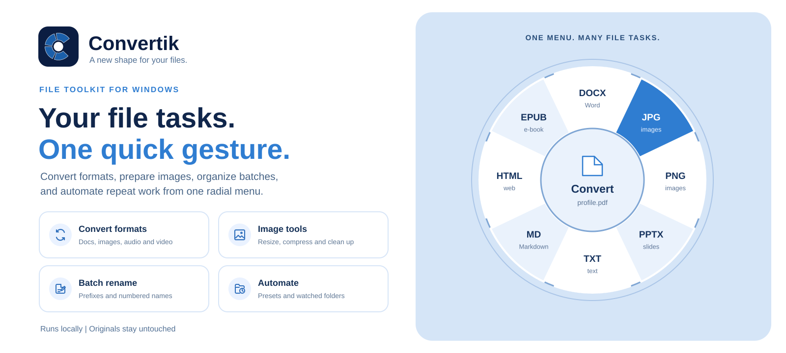

# Convertik

**Convert, resize, rename, and organize files from one quick menu on Windows.**

Drag a file from File Explorer, tap Shift, Ctrl, or Alt, and drop it on an action in Convertik’s radial menu. For batches, select files and use the keyboard shortcut. Processing runs locally on your PC.

[Download ZIP](https://github.com/Kadadji1/Convertik/releases/download/v1.0.1/Convertik-1.0.1-win-x64.zip) · [Privacy](PRIVACY.md) · [Support](https://github.com/Kadadji1/Convertik/issues) · [Build from source](#build-from-source) · [License](LICENSE)

## At a glance

- **Convert:** images, audio, video, PDFs, documents, spreadsheets, subtitles, and archives.
- **Prepare images:** resize to custom dimensions, compress, or remove metadata.
- **Organize:** batch rename files with a prefix and sequential numbering.
- **Automate:** save reusable presets, watch folders, and queue jobs.
- **Act:** copy or move files, inspect paths, and open a terminal at a file location.

Conversions create new output files and leave originals in place. Batch renaming changes selected filenames in place and checks for conflicts first.

## Downloads

**Windows x64:** [Download portable ZIP](https://github.com/Kadadji1/Convertik/releases/download/v1.0.1/Convertik-1.0.1-win-x64.zip) · [Download installer](https://github.com/Kadadji1/Convertik/releases/download/v1.0.1/Convertik-1.0.1-Setup-win-x64.exe)

Extract the portable ZIP completely before running `Convertik.exe`. This is an early release; please [report issues](https://github.com/Kadadji1/Convertik/issues). [Checksums and release notes](https://github.com/Kadadji1/Convertik/releases/tag/v1.0.1).

## Use the radial menu

1. Drag one or more files from File Explorer.
2. While dragging, use **Shift** for conversions, **Ctrl** for tools, or **Alt** for actions. The modifier keys can be changed in Settings.
3. Drop the files on the operation you want. Drop in the center to cancel.

For keyboard use, select files in File Explorer and press **Ctrl + Alt + Space**. Use the arrow keys to choose an item, **Enter** to run it, **Tab** to switch menus, and **Esc** to close the wheel.

Convertik runs in the Windows notification area. Double-click its tray icon to open Settings. On first launch it enables the Explorer context-menu entry and Windows autostart; you can turn either off in Settings. The interface is English-only and supports dark, light, and system themes.

## Formats and requirements

Available operations depend on the input files and installed tools. Images include common formats and many camera RAW formats. Pandoc is bundled for document conversions. FFmpeg can be downloaded from Settings for audio and video operations. LibreOffice must be installed separately for some Office and PDF conversions.

- Windows 10 version 1809 or later, or Windows 11
- 64-bit Windows
- Settings: `%APPDATA%\FileWheel`
- Downloaded tools: `%LOCALAPPDATA%\FileWheel\tools`

Automatic update checks are currently disabled. Download future versions from GitHub Releases.

## Build from source

Build on Windows x64 with PowerShell and the **.NET 10 SDK**. The build downloads the official Pandoc package and verifies its SHA-256, so GitHub Releases must be reachable.

```powershell
./build.ps1
dotnet test tests/FileWheel.Tests -c Release
./publish/Convertik.exe --self-test ./self-test
```

The portable executable is written to `publish/Convertik.exe`. To create an installer, install [Inno Setup 6 or 7](https://jrsoftware.org/isdl.php), then run:

```powershell
./scripts/build-installer.ps1
```

The installer and portable archive are written to `artifacts/`. GitHub Actions runs the Windows tests and package checks. A tagged build (`v*`) publishes the ZIP, installer, and checksums as a GitHub Release.

## License

Distributed under the MIT License. See [LICENSE](LICENSE) and [THIRD-PARTY-NOTICES.md](THIRD-PARTY-NOTICES.md) for copyright and third-party notices.
